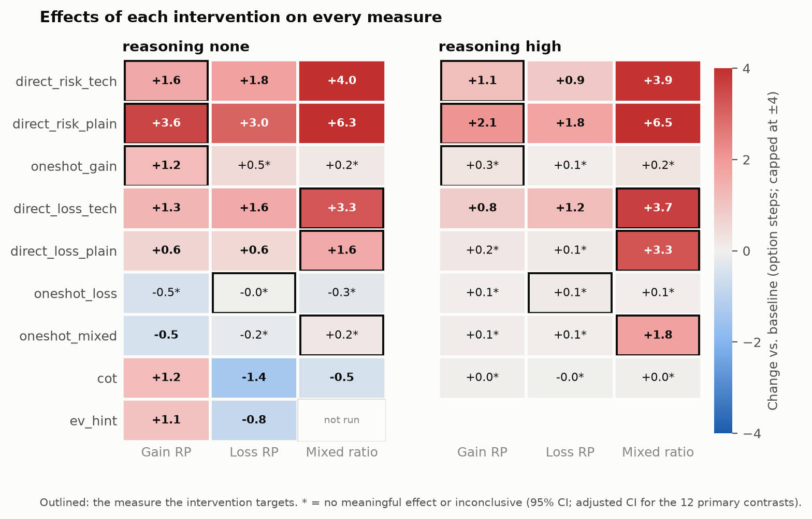

# Can Prompting Shift an LLM's Risk and Loss Preferences?

A pre-registered revisit and extension of Section 4 of Ross, Kim & Lo (2024),
[*"LLM economicus? Mapping the Behavioral Biases of LLMs via Utility Theory"*](https://arxiv.org/abs/2408.02784).

**Status:** complete. Full write-up: [`docs/report.md`](docs/report.md).

The original paper found that telling GPT-4 to be risk or loss averse, or asking it to think step by step,
did not reliably change its choices in a gambling game, while a one-shot example did. This project asks
the same question of a current model (`gpt-6-luna`), with built-in reasoning off and on, in a design
that was pre-registered before any main data were collected, and it also analyzes the reason the model
gives for each set of choices.

## Key findings

1. **Direct instructions work; one-shot examples mostly do not.** "You are risk averse" raises the
   gain-item risk premium by 1.6 option steps and "You are loss averse" raises the loss-aversion ratio
   on mixed gambles by 3.3 steps, with and without reasoning. Of the one-shot examples, only the gain
   example works without reasoning (the reverse of the original paper's result).
2. **Without reasoning, instructions spill over to measures they do not target; with reasoning, much
   less.** "Loss averse" also makes the non-reasoning model risk averse on pure gain and pure loss
   lotteries. With reasoning on, the same instruction moves mainly the mixed-gamble measure.
3. **The model often reads "loss averse" as "avoid losses, prefer certainty".** Its stated reasons show
   this everyday reading on gain and loss items, which explains the spillover. With reasoning, the
   textbook reading ("loss aversion does not apply when all outcomes are gains") dominates.
4. **Without reasoning, the model says it maximizes expected value but often does not.** When the
   stated rule is expected value, the choices match it in 23-67% of valid responses without reasoning
   and in 93-97% with reasoning. Chain of thought and an explicit expected-value hint move behavior
   toward expected value: they fix execution, not intent.



*Change versus baseline in option steps. Outlined cells are the measures each intervention targets;
`*` marks no meaningful effect or an inconclusive result.*

## Why revisit the original study

1. **Loss aversion was not identifiable.** The original infers and teaches loss aversion with pure-loss
   lotteries. In prospect theory the loss-aversion coefficient λ cancels out of the indifference
   condition for pure-loss gambles, so those choices identify only loss-domain curvature. λ is
   identified only by **mixed** lotteries (a chance to gain and a chance to lose in the same gamble),
   which this project adds.
2. **Small samples, no uncertainty.** One model, 10 samples per setting, no confidence intervals.
3. **Older models only**, and no comparison with built-in reasoning.
4. **Most intervention prompts were not published.**
5. **The models' stated reasons were collected but not analyzed.**

## Research questions

- **RQ1.** Can prompting shift an LLM's risk aversion and loss aversion?
- **RQ2.** Does a prompt move the targeted measure without moving the others?
- **RQ3.** Why do interventions succeed or fail, judging from both choices and stated reasons?
- **RQ4.** Does reasoning (none vs. built-in, and prompted chain of thought) change preferences and
  intervention effects?

## Design

Full details: [`docs/preregistration.md`](docs/preregistration.md), committed before the main experiment ran.

- **Model:** `gpt-6-luna` (OpenAI Responses API), `reasoning_effort = "none"` (temperature 1) and `"high"`.
- **Items (60, [`src/items.py`](src/items.py)):** 20 gain lotteries (p in {0.1, ..., 0.9} x stake {$10, $1000} x
  low/high ratio {0.2, 0.5}), the same 20 negated as loss lotteries, and 20 mixed lotteries (50% win G /
  50% lose L; gain or loss varied). Each item is a 12-row list of choices between the lottery and a sure
  amount; rows are shuffled on every call, labels are counterbalanced, and the expected value is not shown.
- **Conditions:** baseline; "risk averse" and "loss averse" instructions, each in technical and plain wording;
  one-shot gain, loss and mixed examples; chain of thought; and an expected-value hint (supplementary).
  Texts in [`prompts/`](prompts/).
- **Outcomes:** range-normalized risk premium (gain and loss items; positive = risk averse), log of the
  switching gain/loss ratio (mixed items), and the share of valid responses.
- **Sample:** 28,600 responses (20 per prompt without reasoning, 5 with), collected through the Batch API with
  all conditions mixed in every batch.
- **Analysis:** per-item paired differences from baseline, item-level bootstrap (10,000 resamples); 12 primary
  contrasts with Bonferroni-adjusted intervals; smallest effect of interest = half an option step.
- **Reason analysis (exploratory):** a codebook built from 112 reasons ([`docs/reason_codebook.md`](docs/reason_codebook.md)),
  validated on 100 hand-labeled reasons, applied to all 28,600 reasons by Claude Haiku 5.5.

## Pre-registered results

| ID | Mode | Condition | Measure | Predicted | Estimate (steps) | Conclusion |
|---|---|---|---|---|---|---|
| P1 | none | `direct_risk_tech` | Gain RP | up | +1.63 | as predicted |
| P2 | none | `direct_risk_plain` | Gain RP | up | +3.59 | as predicted (5 of 20 items usable) |
| P3 | none | `oneshot_gain` | Gain RP | up | +1.21 | as predicted |
| P4 | none | `direct_loss_tech` | Mixed ratio | up | +3.28 | as predicted |
| P5 | none | `direct_loss_plain` | Mixed ratio | up | +1.61 | as predicted |
| P6 | none | `oneshot_mixed` | Mixed ratio | up | +0.19 | inconclusive |
| P7 | none | `oneshot_loss` | Loss RP | up | -0.02 | inconclusive |
| P8 | none | `oneshot_loss` | Mixed ratio | no change | -0.26 | inconclusive (rules out a meaningful increase) |
| P9 | none | `cot` | Gain RP | up | +1.20 | as predicted |
| P10 | none | `cot` | Loss RP | down | -1.38 | as predicted |
| P11 | high | `direct_risk_tech` | Gain RP | up | +1.12 | as predicted |
| P12 | high | `direct_loss_tech` | Mixed ratio | up | +3.69 | as predicted |

Nine of twelve as predicted, three inconclusive, none in the opposite direction. The conclusions of
P1-P5, P7 and P10-P12 hold in every pre-registered sensitivity analysis; the weak one-shot effects
(P6, P8) depend on how the mixed gambles are elicited. Deviations from the pre-registration are listed
in the report (Section 4) and logged with dates in [`notes/lab_log.md`](notes/lab_log.md).

## Repository layout

```
docs/                 pre-registration, report, reason codebook, original project plan
notes/lab_log.md      every design decision and deviation, with dates
prompts/              system and user templates; prompts/interventions/ holds the intervention texts
data/items/           the 60 generated items
data/raw/             raw model responses (JSONL), with everything needed to rebuild each prompt
data/batch/           Batch API metadata
data/labels/          LLM labels of the reasons (raw records)
src/                  item generation, prompts, API calls, parsing, analysis, labeling, figures
results/tables/       contrast and level tables (primary, S1-S6, sensitivity summary)
results/reasons/      reason samples, hand labels, validation, spot checks, step4/ analysis tables
results/figures/      report figures
```

## Reproducing

```bash
pip install -r requirements.txt
cp .env.example .env        # add OPENAI_API_KEY (data collection) and ANTHROPIC_API_KEY (reason labeling)
```

Analysis only, from the committed data (no API calls):

```bash
python src/analyze_main.py --run main                         # primary analysis
python src/analyze_main.py --run main --include-invalid       # sensitivity analysis S1
python src/analyze_main.py --run main --subset moderate_p     # S3-S6: also extreme_p, version1, version2,
                                                              #         mixed_A, mixed_B, uncensored
python src/sensitivity_summary.py --run main                  # all sensitivity analyses in one table
python src/position_check.py --runs main --mode none --conditions baseline oneshot_gain oneshot_loss
python src/reason_analysis.py                                 # reason analysis tables
python src/make_figures.py                                    # report figures
```

Re-collecting data (costs API credits):

```bash
python src/batch.py plan --run main --part-size 3000          # then: submit, status, collect, retry
python src/label_reasons.py label --model claude-haiku-5-5 --thinking disabled      # validation sample
python src/label_reasons.py agreement --model claude-haiku-5-5 --thinking disabled
python src/label_batch.py plan --run main --name main_v2 --model claude-haiku-5-5 --thinking disabled
                                                              # then: submit, status, collect, merge
```

The model is available only as an alias without a dated snapshot, so re-collected data may differ.

## Author

Dora Zang, Applied Mathematics, University of Waterloo