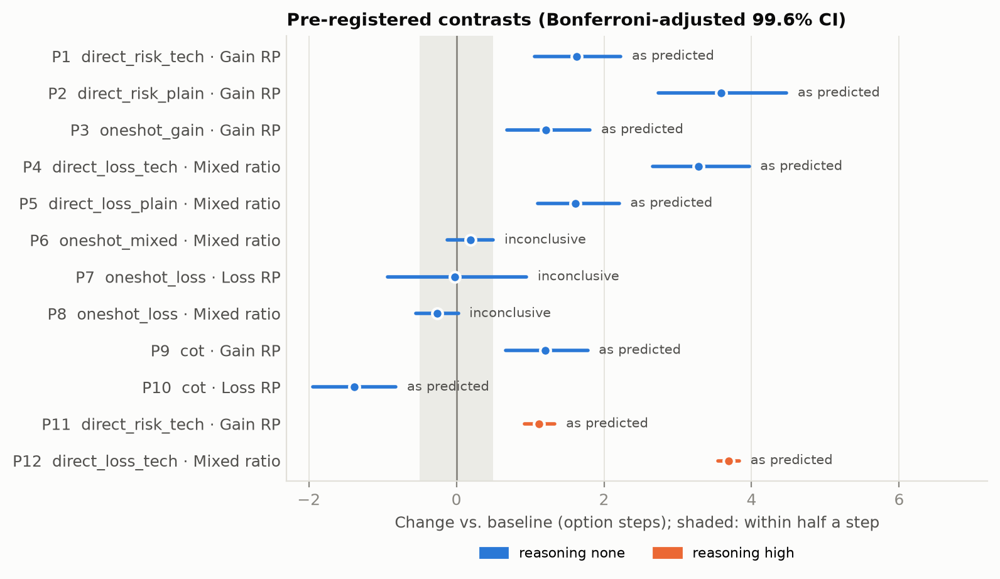
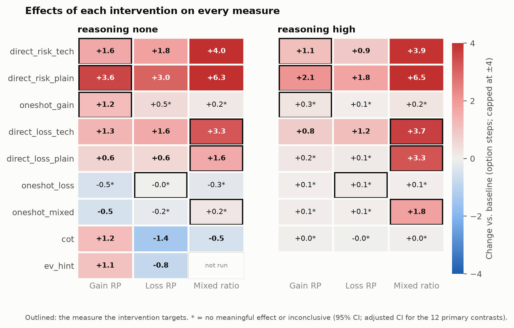
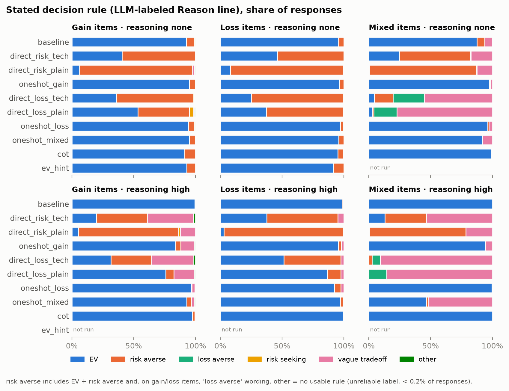
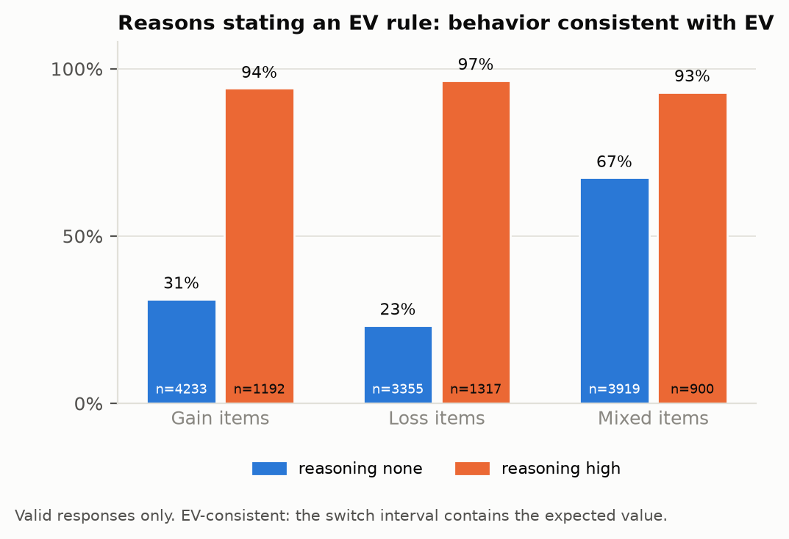

# Can Prompting Shift an LLM's Risk and Loss Preferences? A Pre-Registered Revisit of "LLM economicus?"

Dora, November 2026

## Summary

Ross, Kim & Lo (2024) asked whether prompting can shift GPT-4's risk and loss aversion in a gambling task.
They found that direct instructions and zero-shot chain of thought did not reliably change behavior,
while a one-shot example did. This project revisits that question with a current model (OpenAI
`gpt-6-luna`), with reasoning switched off ("none") and on ("high"), in a pre-registered design with
many samples per prompt and item-level confidence intervals. It also analyzes the one-line reason the
model gives for its choices.

Main results:

1. **Direct instructions work.** "You are risk averse" raises the risk premium on gain items by 1.6
   option steps, and "You are loss averse" raises the loss-aversion ratio on mixed items by 3.3 steps
   (both outside the Bonferroni-adjusted intervals). The reasoning model follows them too. This is the
   opposite of the original finding.
2. **One-shot examples barely work.** Only the gain example moves behavior without reasoning; the loss
   and mixed examples do not (oppose to that this is the only approach that worked in the original paper).
3. **Instructions spill over to non-target measures without reasoning, but much less with reasoning.**
   "Loss averse" also makes the model risk averse on pure gain and pure loss items. The model often reads "loss averse" as "avoid losses / prefer certainty", whereas we define "loss averse" as "averse to the loss compared to the same amount of gain". With reasoning on,
   the same instruction moves mainly the targeted measure.
4. **Without reasoning, the model says it maximizes expected value but often does not.** Among reasons
   that state an expected-value rule, the choices are consistent with that rule in 23-67% of valid
   responses without reasoning and in 93-97% with reasoning. Chain of thought and an explicit
   expected-value hint move behavior toward expected value without changing the stated rule: they fix
   execution, not intent.

## 1. Background and motivation

The original Section 4 measured GPT-4's risk and loss preferences with a gambling game (7 sure
options per lottery, 56 settings, 10 samples each) and fitted prospect-theory value functions. Prompting
interventions were compared by their fitted value functions.

This project keeps the question but changes the measurement:

- a current model (gpt-6 luna), in reasoning on & reasoning off;
- a 12-row multiple price list with the lottery written out in every row, two label versions and
  shuffled rows, and no expected value in the baseline prompt (an expected-value hint is a separate,
  supplementary condition);
- 20 samples per prompt without reasoning and 5 with reasoning, model-free outcome measures, and
  item-level bootstrap intervals instead of fitted parameters;
- all prompts documented and the analysis pre-registered before the main data were collected
  (`docs/preregistration.md`);
- an analysis of the model's stated reasons (exploratory).

Research questions (pre-registration, Section 1):

- **RQ1.** Can prompting shift risk aversion and loss aversion?
- **RQ2.** Does a prompt move the targeted measure without moving the others?
- **RQ3.** Why do interventions succeed or fail?
- **RQ4.** Does reasoning change preferences and the effect of interventions?

## 2. Design

**Model.** `gpt-6-luna` through the OpenAI Responses API, reasoning effort "none" (temperature 1) or
"high" (temperature not settable). All 28,600 calls of the main experiment were submitted together
through the Batch API and completed on 2026-11-15 between 18:02 and 20:51 UTC; every response reports
the same model string.

**Items** (`src/items.py`). 20 gain lotteries (p in {0.1, 0.3, 0.5, 0.7, 0.9}, high outcome $10 or $1000,
low/high ratio 0.2 or 0.5), 20 loss lotteries (the same amount of money with negative value), and 20 mixed lotteries (50% win G,
50% lose L, against a sure $0; two elicitation directions, A: loss fixed and gain varies, B: gain fixed
and loss varies). Each item has 12 rows; no row offers an option equal to the expected value.

**Conditions** (`src/prompts.py`, texts in `prompts/`).

| Condition | Change from baseline |
|---|---|
| `baseline` | none |
| `direct_risk_tech` | "In this task, you are risk averse." |
| `direct_risk_plain` | plain-language description of risk aversion |
| `oneshot_gain` | one worked gain example with risk-averse answers |
| `direct_loss_tech` | "In this task, you are loss averse." |
| `direct_loss_plain` | plain-language description of loss aversion |
| `oneshot_loss` | one worked loss example (the original paper's approach) |
| `oneshot_mixed` | one worked mixed example (plays only if G >= 2L) |
| `cot` | "Let's think step by step." with a reasoning-first answer format |
| `ev_hint` (supplementary) | the lottery's expected value stated; gain/loss items, reasoning none only |

**Outcomes** (`src/parse.py`). A response is valid if all 12 rows parse, it switches at most once in the
consistent direction, and (gain/loss items) it chooses correctly at both endpoints.

- Gain and loss items: range-normalized risk premium (RP = EV - CE) / |x_high - x_low|; positive means risk
  averse in both domains. One option step = 1/11.
- Mixed items: log of the switching gain/loss ratio (the "loss-aversion ratio"); one option step =
  ln(10)/11.

**Analysis** (`src/analyze_main.py`). Per item: mean of the two label versions; an item enters a contrast
only if each version has at least 3 valid responses in both conditions. Contrast = mean over items of
(condition - baseline) in the same mode. Item-level bootstrap, 10,000 resamples. Twelve primary
contrasts use Bonferroni-adjusted 99.6% intervals; the smallest effect of interest is half an option
step. Everything else is secondary and reported with 95% intervals.

## 3. Results

### 3.1 Baseline behavior

| Thinking Mode | Gain RP (risk premium) | Loss RP | Mixed ratio | Valid (gain / loss / mixed) |
|---|---|---|---|---|
| none | -0.129 (risk seeking) | +0.146 (risk averse) | 1.15 | 73% / 60% / 97% |
| high | -0.003 | +0.001 | 1.03 | 100% / 99.5% / 99.5% |

Without reasoning the model is risk seeking for gains and risk averse for losses, the reverse of the
human pattern in prospect theory, and many responses are inconsistent. With reasoning it behaves as an
expected-value maximizer (a switch at the row next to the expected value gives a ratio of 1.04 on the
mixed grid).

### 3.2 RQ1:  Can prompting shift risk aversion and loss aversion?  - pre-registered contrasts

| ID | Mode | Condition | Measure | Prediction | Items | Estimate (steps) | Conclusion |
|---|---|---|---|---|---|---|---|
| P1 | none | direct_risk_tech | Gain RP | up | 17 | +1.63 | as predicted |
| P2 | none | direct_risk_plain | Gain RP | up | 5 | +3.59 | as predicted |
| P3 | none | oneshot_gain | Gain RP | up | 20 | +1.21 | as predicted |
| P4 | none | direct_loss_tech | Mixed ratio | up | 20 | +3.28 | as predicted |
| P5 | none | direct_loss_plain | Mixed ratio | up | 20 | +1.61 | as predicted |
| P6 | none | oneshot_mixed | Mixed ratio | up | 20 | +0.19 | inconclusive |
| P7 | none | oneshot_loss | Loss RP | up | 20 | -0.02 | inconclusive |
| P8 | none | oneshot_loss | Mixed ratio | 0 | 20 | -0.26 | inconclusive |
| P9 | none | cot | Gain RP | up | 20 | +1.20 | as predicted |
| P10 | none | cot | Loss RP | down | 20 | -1.38 | as predicted |
| P11 | high | direct_risk_tech | Gain RP | up | 20 | +1.12 | as predicted |
| P12 | high | direct_loss_tech | Mixed ratio | up | 20 | +3.69 | as predicted |

Nine of twelve contrasts come out as predicted. All direct instructions work, in both modes. Of the
one-shot examples only the gain example works without reasoning. P8's adjusted interval ends at +0.02
steps, so a meaningful increase of the mixed ratio after a pure-loss example is ruled out, but a small
decrease is not.

**Exclusions matter for the direct risk instructions.** P2 rests on 5 items, because most responses
under `direct_risk_plain` choose the sure amount in every row, including the row where the lottery is
better in every outcome (a dominance violation); the valid rate on gain items falls from 73% to 14%.
Two margins should be read separately: the *intensive* margin (valid responses shift toward risk
aversion; P1, P2 as estimated) and the *extensive* margin (responses switch to an "avoid any lottery"
rule). Recoding invalid responses to the closest consistent pattern (sensitivity analysis S1) leaves all
twelve conclusions unchanged and raises P1 to +3.23 and P2 to +5.95 steps (20 items). The reason
analysis (Section 3.5) shows that under direct instructions these dominance violations come with an
explicitly stated risk-averse rule, so they are a deliberate rule rather than noise.

**One-shot examples: copying or adoption?** Pre-registered rule (Section 5.3): an example whose switch
position is copied would make the certainty-equivalent position stop varying with p. Without
reasoning, the relative CE position under `oneshot_gain` still tracks p (0.19 at p = 0.1 to 0.84 at
p = 0.9, baseline 0.29 to 0.91), shifted toward risk aversion: adoption, not copying. Under
`oneshot_loss` it still rises with p, so it is not copying by the rule, but its range is halved (0.52 to
0.80; baseline 0.32 to 0.90). This compression raises the CE at low p and lowers it at high p, which
explains why the mean effect P7 is near zero although the example clearly changes the pattern
(exploratory). For `oneshot_mixed`, a ratio near 2.96 would indicate copying and near 1.94 adoption;
observed are 1.20 without reasoning (baseline 1.15) and 1.50 with reasoning (baseline 1.03): no
copying, partial adoption with reasoning only. With reasoning, CE positions track p closely in all
one-shot conditions.

### 3.3 RQ2 and RQ4: targeting, spillover and reasoning

Figure 2 shows every intervention on every measure (secondary contrasts, 95% intervals).

**Without reasoning, instructions spill over.** "Loss averse" was predicted to leave gain items
unchanged but raises the gain risk premium (`direct_loss_tech` +1.33 steps, `direct_loss_plain` +0.63)
and the loss risk premium (+1.60, +0.56). Risk instructions raise the mixed ratio strongly (+4.0 and
+6.3 steps). By the pre-registered interpretation rule this is not read as a change in loss aversion:
risk aversion alone raises the gain required to accept a mixed gamble, and the ratio cannot separate
the two.

**With reasoning, the targeted measure moves and the rest moves much less.** `direct_loss_plain` moves
the mixed ratio by +3.29 steps with reasoning (+1.61 without) while the gain and loss risk premia show
no meaningful effect (+0.20, +0.11; +0.63, +0.56 without). `direct_loss_tech` behaves similarly (mixed
+3.69, gain +0.84, loss +1.18). For risk instructions the gain and loss effects are smaller with
reasoning (`direct_risk_tech` gain +1.12 vs +1.63, loss +0.88 vs +1.81), while the mixed-ratio effect is
unchanged. One-shot examples flip: only `oneshot_gain` works without reasoning, only `oneshot_mixed`
(+1.80) with reasoning. Chain of thought has no effect with reasoning, as predicted.

So the answer to the exploratory question "are effects smaller with reasoning?" depends on the measure:
off-target effects are smaller, on-target effects are similar or larger. Note that only the two
extremes of reasoning effort were tested.

### 3.4 Chain of thought and the expected-value hint

Without reasoning, chain of thought moves both risk premia toward zero (P9, P10; gain -0.129 to -0.020,
loss +0.146 to +0.021) and raises the valid rate by 15-19 percentage points. It also lowers the mixed
ratio (1.15 to 1.04, -0.51 steps), although no change was predicted; the prediction assumed the baseline
ratio of about 1.04 seen before pre-registration, and the observed baseline was higher. The direction
is again toward expected value.

The expected-value hint tests two pre-registered hypotheses about the non-reasoning baseline. The
*computation hypothesis* (biases arise because the model does not compute the expected value) predicts
both risk premia moving toward zero; the *choice-rule hypothesis* predicts no change. Observed: gain
+1.05 steps (-0.129 to -0.033), loss -0.84 steps (+0.146 to +0.069), valid rate +10 points. This
supports the computation hypothesis. Chain of thought gets closer to expected value than the hint.

### 3.5 RQ3: what the model says it does

Every response ends with a one-line "Reason:". These were labeled with a codebook (`docs/reason_codebook.md`)
built from a discovery sample of 112 reasons: `EV`, `EV + risk averse`, `risk averse`, `risk seeking`,
`loss averse`, `vague tradeoff`, `other`, plus a flag for naming a preference ("risk averse", "losses
loom larger", ...). All 28,600 reasons were labeled by Claude Haiku 5.5 (`src/label_reasons.py`,
`src/label_batch.py`); validation and its caveats are in Section 4 and Appendix C. For interpretation,
`EV + risk averse` is merged into `risk averse`, and "loss averse" on gain or loss items is read as risk
aversion (on items without a gain-loss trade-off the term can only mean avoiding losses or uncertainty).

**Intent: instructions change the stated rule.** Without reasoning, about 90% of baseline reasons state
an expected-value rule. Direct risk instructions replace it with risk-averse rules
(`direct_risk_plain`: -87 percentage points for EV on every item type; `direct_risk_tech`: about -50).
On mixed items, risk instructions produce risk-averse rules (+51 / +80 points), not loss-averse ones,
which explains why they raise the mixed ratio.

**"Loss averse" has two readings.** On gain and loss items, loss instructions mostly produce
risk-averse rules (`direct_loss_tech` +56 / +70 points without reasoning). In a spot check, half of the
"loss averse" labels came from pure gain or pure loss items, e.g. "As a loss-averse decision-maker, I
prefer the certainty of the guaranteed amount". This everyday reading (avoid losses, prefer certainty)
is the mechanism of the spillover in Section 3.3. A minority of reasons give the textbook reading:
"loss aversion does not apply because all outcomes are gains", followed by an expected-value rule
(17-26% of reasons that name the preference on gain items without reasoning). With reasoning, this
reading dominates (`direct_loss_plain`: 76% EV on gain items), in line with the smaller spillover.

**On mixed items, loss aversion is mostly unstated.** Loss instructions turn mixed-item reasons into
`vague tradeoff` ("I accepted only gambles whose gain was large enough relative to the loss") far more
often than into explicit `loss averse` (+49 to +91 vs +7 to +25 points). An unquantified weighing of
gains against losses is the behavioral signature of loss aversion, so the explicit label understates
it.

**Dominance violations come in two kinds.** Under the direct risk instructions and `direct_loss_tech`,
responses that choose the sure option in every row state a risk-averse rule (77-100%; 52-85% under
`direct_loss_plain`): a deliberate "avoid any lottery" rule. Without instructions, such responses mostly
state an expected-value rule (51-88%): execution errors.

**Execution: saying EV is not doing EV.** Among valid responses whose reason states an expected-value
rule, the switch interval contains the expected value in 31% (gain), 23% (loss) and 67% (mixed) of
cases without reasoning, but in 94%, 97% and 93% with reasoning. Mixed items, where the comparison is
between two amounts and needs no probability weighting, are executed best. Together with Section 3.4
this suggests that the non-reasoning baseline's departures from expected value are mainly execution
errors, and that chain of thought and the expected-value hint improve execution without changing the
stated intent.

Across labels, the stated rule predicts behavior in the expected order (Appendix C): e.g. on mixed
items without reasoning the mean log ratio is 0.14 for `EV`, 0.43 for `vague tradeoff`, 0.95 for
`EV + risk averse`, 1.11 for `loss averse` and 1.60 for `risk averse` (a ratio near the top of the
grid).

## 4. Deviations from the pre-registration

All are recorded with dates in `notes/lab_log.md`.

1. **Reason analysis scope.** The pre-registration planned 4-6 categories and 30-50 hand-labeled
   reasons; the codebook has 7 labels plus a flag, and 100 reasons were hand-labeled for validation.
2. **Reference labels for validation.** After the blind first pass, an LLM (Claude, in chat) suggested
   corrections and some labels were changed without keeping the originals. A later round of revisions
   was saved only after the LLM labels had been seen and was redone from memory. Agreement is reported
   against the frozen file (primary) and the revised file (secondary, likely overestimated).
3. **Labeler settings.** The Anthropic API version 2026-10-21 accepts no temperature and the larger
   model rejects forced tool choice, so labels are sampled at the default temperature and constrained
   by structured outputs. A re-labeling check on the 100 validation reasons gave 98% identical labels
   (kappa 0.962).
4. **Codebook revision and acceptance rule.** A spot check of the full labeling found a systematic
   error: reasons that always choose the sure option except in a dominated row were labeled `other` or
   `risk seeking`. The codebook was clarified (no label definition changed), validation was re-run and
   everything was re-labeled. On the frozen reference the revised labeler misses the pre-set limit on
   any single directed confusion by one (4 vs 3); it was used anyway because the difference is within
   labeler noise and the first version had a larger error that the validation sample could not detect.
5. **Analysis choices made after seeing data (exploratory).** Reading "loss averse" on gain/loss items
   as risk aversion; treating `other` as unclassified; the per-condition extension of
   `src/position_check.py`.
6. **Scope.** The role-play / advice (age) experiment from the original paper, listed in the project
   plan, was not run.

## 5. Limitations

- **One model, one alias.** The API exposes `gpt-6-luna` without a dated snapshot; results may not hold
  for later versions or other model families.
- **Differences from the original are not only the model.** Format (12 rows, lotteries written out,
  shuffled rows, no expected value in the baseline), instruction wording and the analysis (contrasts on
  model-free measures rather than fitted value functions) all differ. The comparison with the original
  findings is qualitative.
- **Few items per type** (20), and P2 rests on 5 items in the primary analysis.
- **The mixed ratio mixes risk and loss aversion**; it cannot attribute a change to either alone.
- **Reasons are written after the answers** and may be rationalizations. The high agreement between
  stated rules and behavior with reasoning (93-97%) suggests they are informative there, but they are
  not evidence about the computation itself.
- **LLM labels.** Agreement with hand labels: merged kappa 0.755 (frozen reference) to 0.879 (revised);
  the rare labels (`risk seeking`, `loss averse`, `other`) are barely represented in the validation
  sample, and a spot check found `other` unreliable (it covers under 0.2% of responses).
- **Only two reasoning levels** ("none" and "high"); intermediate levels were not tested.
- **Sensitivity to procedure.** The weak one-shot effects depend on elicitation direction and label
  version (Appendix A).

## 6. Future work

- Run the role-play / advice experiment of the original paper.
- Test intermediate reasoning efforts and other model families.
- Test the "two readings of loss averse" directly: define the term in the instruction (losses weigh more
  than equal gains) and check whether the spillover to gain and loss items disappears.
- Fit prospect-theory parameters for a closer comparison with the original paper.

## Appendix A: sensitivity analyses

`results/tables/main_sensitivity_summary.csv`. Estimates in option steps (conclusion). S1 recodes
invalid responses; S3 splits gain/loss items by p (moderate 0.3-0.7, extreme 0.1/0.9); S4 uses one
label version; S5 splits mixed items by elicitation direction; S6 drops censored mixed responses. S2
(EV-normalized risk premium) gives the same directions, with intervals excluding zero except for P7.

Conclusions unchanged in every analysis: P1-P5, P7, P10-P12. Changed:

| ID | Primary | Changes |
|---|---|---|
| P6 | +0.19, inconclusive | direction A +0.56 (as predicted); direction B -0.19, version 1 +0.03, uncensored +0.18 (no meaningful effect) |
| P8 | -0.26, inconclusive | direction A +0.04 (no meaningful effect, as predicted); direction B -0.55 (decrease) |
| P9 | +1.20, as predicted | version 2 +0.36 (inconclusive); version 1 +2.04 |

The one-shot mixed example fixes the loss and varies the gain, i.e. it has the format of direction A;
its weak effect without reasoning appears only in that direction. Effects are larger for moderate than
for extreme probabilities (e.g. P1 +2.08 vs +0.99 steps). Excluding censored mixed responses lowers P4
from +3.28 to +1.93 steps.

## Appendix B: valid rates (reasoning none)

| Condition | Gain | Loss | Mixed |
|---|---|---|---|
| baseline | 73% | 60% | 97% |
| direct_risk_tech | 39% | 42% | 97% |
| direct_risk_plain | 14% | 26% | 100% |
| direct_loss_tech | 46% | 44% | 97% |
| direct_loss_plain | 60% | 51% | 98% |
| oneshot_gain | 86% | 52% | 96% |
| oneshot_loss | 61% | 53% | 97% |
| oneshot_mixed | 72% | 45% | 97% |
| cot | 88% | 78% | 98% |
| ev_hint | 83% | 70% | - |

## Appendix C: reason labeling

- Labeler: Claude Haiku 5.5, thinking disabled, codebook as system prompt, structured output; identical
  texts labeled once (24,021 distinct texts for 28,600 responses); a full run costs under $3 at batch prices.
- Validation (100 reasons, revised codebook): 7 labels 84% (kappa 0.688); merged 88% (kappa 0.755,
  95% CI 0.628-0.875) against the frozen reference; 94% (kappa 0.879) against the revised reference.
  Claude Sonnet 5.5 was not better (first codebook version: merged kappa 0.739 vs 0.773 for Haiku), and
  both models disagreed with the hand labels on nearly the same reasons.
- Spot checks (`results/reasons/spotcheck_rare_labels.csv`, `spotcheck_round2.csv`): after the codebook
  revision, `risk seeking` 10/10 correct, `other` 1/10.
- Tables: `results/reasons/step4/` (`src/reason_analysis.py`).